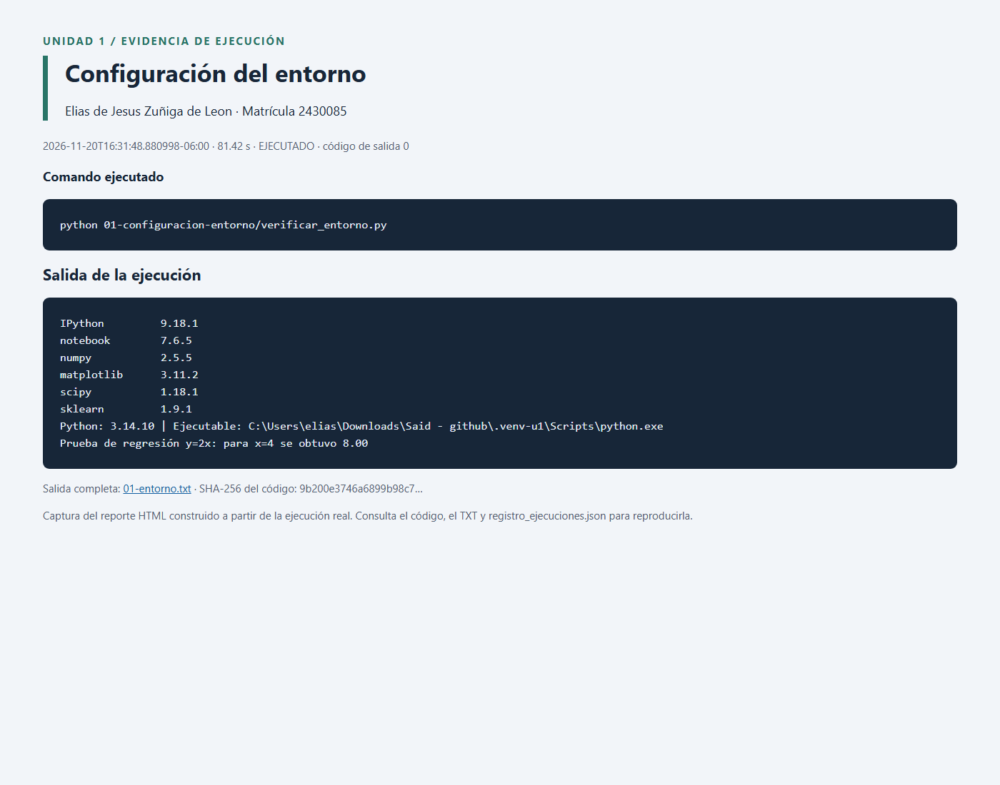

# 1. Configuración del entorno

Se verifican las importaciones de IPython, Notebook, NumPy, Matplotlib, SciPy y scikit-learn. Después se ajusta una regresión a `y=2x`: al predecir `x=4` se obtiene `8.00`.

- Código: [verificar_entorno.py](verificar_entorno.py).
- Cuaderno: [actividad.ipynb](actividad.ipynb).
- Versiones: [resultados/versiones.json](resultados/versiones.json).
- [Salida completa](../evidencias/01-entorno.txt).

