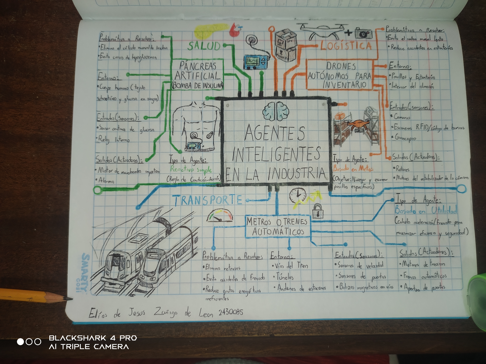

# Mapa mental de agentes inteligentes

Mapa mental de agentes inteligentes en salud, logística y transporte. Incluye la problemática, el entorno, las entradas, las salidas y el tipo de agente de cada ejemplo.

[Abrir imagen original](Mapa_Mental_2430085.jpg)

