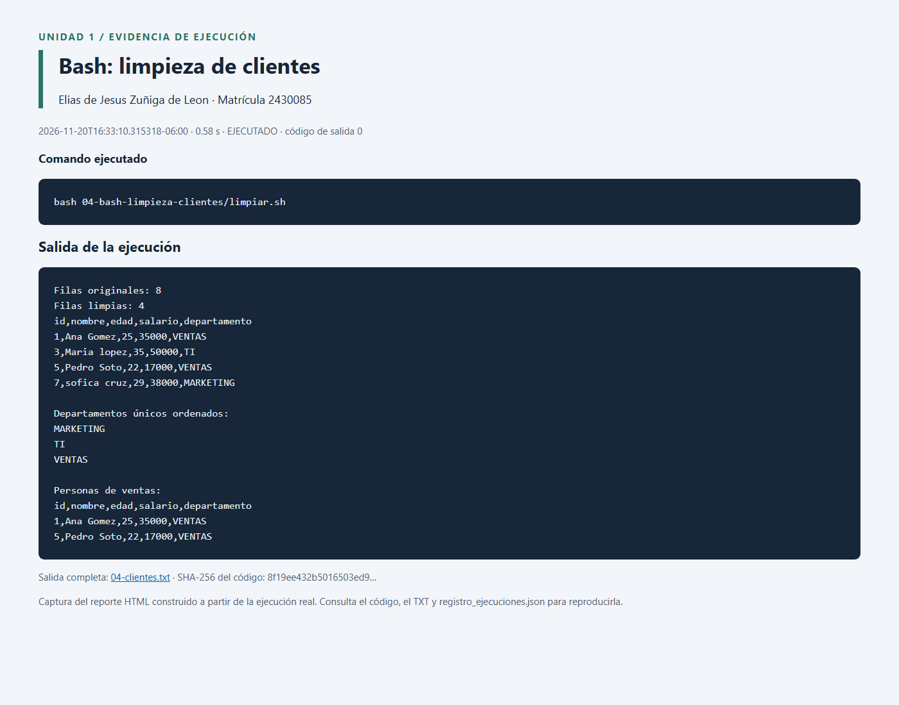

# 4. Limpieza de clientes con Bash

Objetivo: limpiar espacios, unificar departamentos, eliminar duplicados por ID y descartar registros sin edad o salario numéricos. El CSV de ejemplo tiene ocho filas; quedan cuatro registros válidos. No se imputan edades ni salarios.

Desde Git Bash, dentro de esta carpeta:

```bash
bash limpiar.sh
```

El código usa `awk`, `cut`, `tail` y `sort`. Está diseñado para el CSV sencillo incluido, cuyos campos no contienen comas internas. Respeta los nombres del archivo de entrada; no corrige nombres por suposición.

Resultados:

- [Clientes limpios](resultados/clientes_limpios.csv): cuatro registros.
- [Departamentos únicos](resultados/departamentos.txt): MARKETING, TI y VENTAS, ordenados.
- [Personas de ventas](resultados/ventas.csv): Ana Gomez y Pedro Soto.
- [Salida de ejecución](../evidencias/04-clientes.txt).

El [dataset de entrada](datos/clientes_sucio.csv) procede del ejemplo del repositorio de referencia; el script y sus resultados son de esta reconstrucción.


