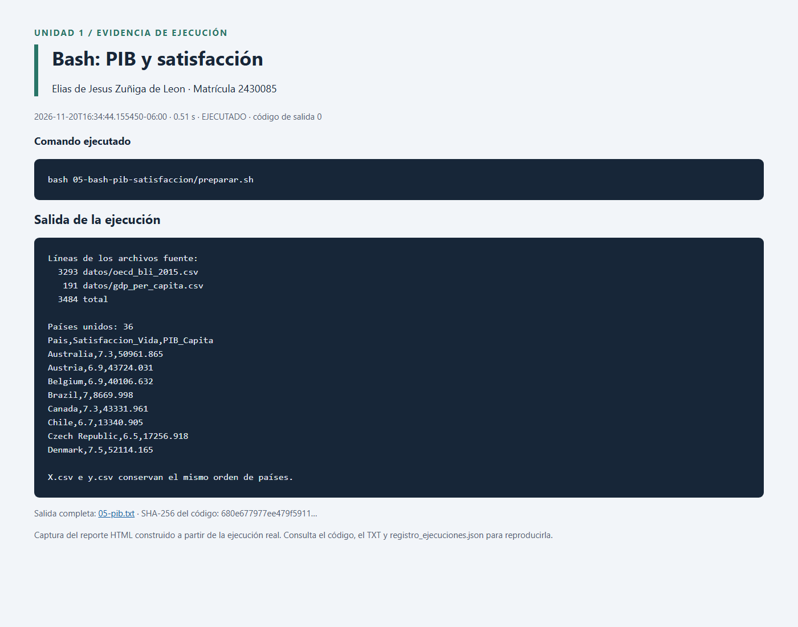

# 5. PIB per cápita y satisfacción de vida

Objetivo: preparar entradas y salidas para una regresión uniendo la satisfacción de vida de la OCDE y el PIB per cápita del FMI de 2015.

```bash
bash preparar.sh
```

Se requiere GNU Awk 5.3 o posterior para leer el CSV con comillas. El script selecciona `SW_LIFS` y `TOT`, convierte la fuente del FMI de Latin-1 a UTF-8, elimina separadores de millares y descarta valores faltantes. Ordena las dos tablas por país y aplica `join`.

La unión produce **36 países**. [merged_data.csv](resultados/merged_data.csv) conserva país, satisfacción y PIB. [X.csv](resultados/X.csv) contiene PIB y [y.csv](resultados/y.csv) satisfacción, sin encabezados y con la misma alineación. No se entrenó un modelo con esos datos en esta actividad: el entregable es su preparación.

Los [dos archivos fuente](datos/) proceden del repositorio original de Aurélien Géron, que documenta su origen OCDE/FMI; consulta [REFERENCIAS.md](../REFERENCIAS.md). La validación de la unidad recalcula la unión con el lector CSV de Python para comprobar los resultados del script Bash.


