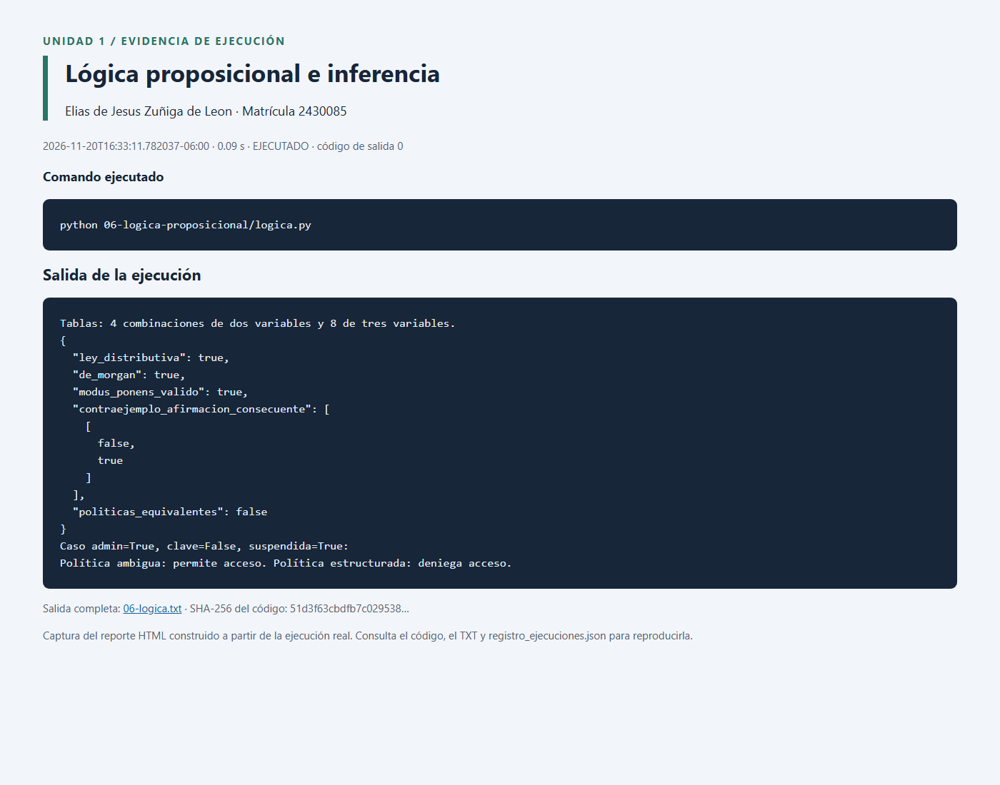

# 6. Lógica proposicional e inferencia

[logica.py](logica.py) implementa NOT, AND, OR, XOR, implicación, bicondicional, NAND y NOR. Enumera las combinaciones booleanas para comprobar las leyes distributiva y de De Morgan, y valida modus ponens.

La afirmación del consecuente no es válida: `p=False, q=True` satisface `p→q` y `q`, pero no `p`. El motor guarda ese contraejemplo.

En el caso de control de acceso se comparan `p OR (q AND NOT r)` y `(p OR q) AND NOT r`. Con administrador verdadero, clave falsa y cuenta suspendida, la primera permite acceso y la segunda lo niega. El ejemplo muestra que los paréntesis cambian el significado de una regla; no es una prueba de seguridad de un sistema real.

- [Cuaderno ejecutado](actividad.ipynb).
- [Tabla de operadores](resultados/operadores.csv).
- [Ocho casos de acceso](resultados/acceso.csv).
- [Resultados de equivalencia e inferencia](resultados/resultados.json).

