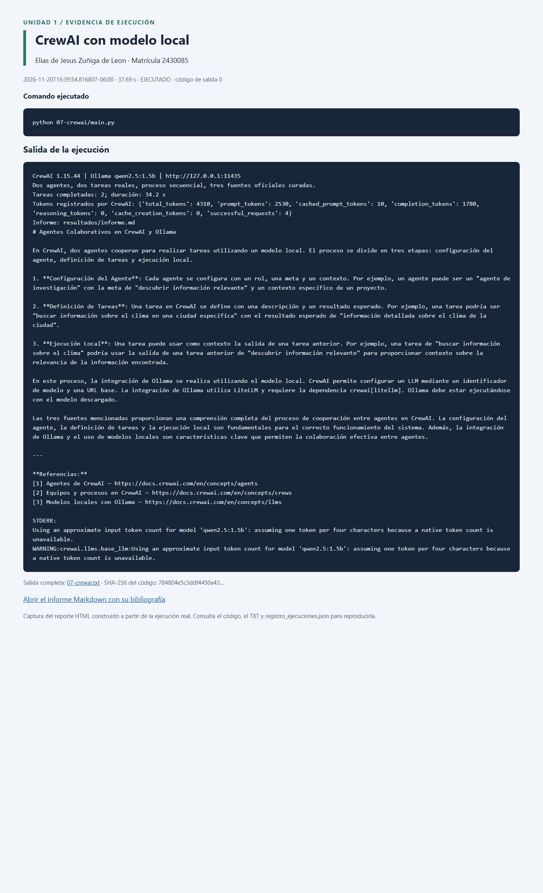

# 7. Investigación y redacción con CrewAI

Práctica con dos agentes reales: un analista revisa las tres fuentes de [fuentes.json](fuentes.json) y un redactor usa ese análisis para preparar un informe. El proceso es secuencial. Ambos usan `qwen2.5:1.5b` mediante Ollama local.

Esta implementación usa fuentes oficiales seleccionadas previamente. No necesita Serper ni realiza una búsqueda automática en Internet. Es una adaptación de la práctica para poder ejecutarla localmente sin claves de API.

## Ejecutar

Desde la carpeta que contiene la unidad:

```powershell
& .\Fundamentos_IA_Unidad_1\herramientas\iniciar_ollama.ps1
.\.venv-u1\Scripts\python.exe .\Fundamentos_IA_Unidad_1\reproducir.py --solo 07-crewai --incluir-crewai
```

[main.py](main.py) usa el entorno Python 3.12 `.venv-crewai`. La configuración opcional está en [.env.example](.env.example); los valores predeterminados ya corresponden a este equipo. Los pasos de instalación están en [EJECUTAR.md](../EJECUTAR.md).

Se completaron las dos tareas en aproximadamente **34 segundos** y CrewAI registró **4310 tokens** en total (el conteo de entrada es aproximado para este modelo). Los archivos generados son [analisis.md](resultados/analisis.md), [informe.md](resultados/informe.md) y [ejecucion.json](resultados/ejecucion.json). Este último conserva ambos agentes, sus salidas, el modelo y las métricas reportadas por CrewAI.

El texto generado se conserva tal como lo entregaron los agentes; el programa añade una bibliografía con las fuentes de entrada. La revisión detectó que el modelo introduce ejemplos de clima que no se probaron y no desarrolla todas las limitaciones solicitadas. Esos ejemplos son ilustrativos. El experimento realizado fue analizar un dossier y redactar un informe; las fuentes fueron seleccionadas antes de ejecutar.

La integración concreta de CrewAI 1.15.44 detecta Ollama como proveedor compatible con OpenAI y usa el servidor local. El paquete instalado incluye el extra LiteLLM conforme a la documentación de preparación, aunque esta versión puede elegir su cliente nativo. No se envió el trabajo a un proveedor externo de modelos.


