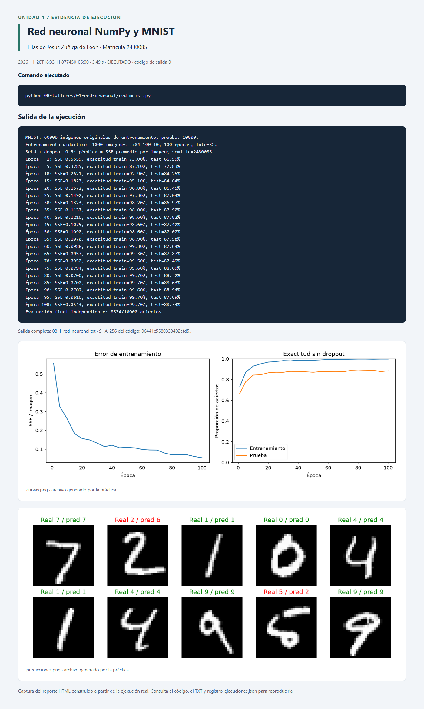

# 8.1. Red neuronal feedforward con NumPy y MNIST

Objetivo: clasificar dígitos manuscritos del 0 al 9 mediante una red escrita sin TensorFlow. [red_mnist.py](red_mnist.py) lee los archivos IDX y normaliza los 784 píxeles de cada imagen a `[0,1]`.

La arquitectura es **784 → 100 → 10**, con ReLU, dropout de 0.5 durante el entrenamiento y salida lineal. La clase elegida es el índice de la mayor puntuación. La pérdida es la suma de errores cuadrados por imagen. Se entrenan 100 épocas con 1000 imágenes, lotes de 32, tasa 0.08 y semilla 2430085. La derivada de dropout incluye el factor de escala de las activaciones. A diferencia de la guía de referencia, esta implementación usa mini lotes y sesgos.

La ejecución obtuvo **99.70 % en entrenamiento y 88.34 % en las 10 000 imágenes de prueba**, sin dropout al evaluar. La diferencia indica sobreajuste a la muestra pequeña. La curva de prueba se muestra con fines didácticos; no se seleccionó el mejor punto para cambiar el número fijo de épocas.

- [Cuaderno ejecutado](actividad.ipynb).
- [Métricas](resultados/metricas.json), [historial](resultados/entrenamiento.csv) y [matriz de confusión](resultados/matriz_confusion.csv).
- [Pesos entrenados](resultados/pesos.npz).
- [Predicciones de diez imágenes](resultados/predicciones.png).

La red aprende patrones numéricos a partir de ejemplos etiquetados. Para cada nueva imagen calcula diez puntuaciones y elige la mayor. Las puntuaciones lineales no son probabilidades calibradas.

```powershell
python red_mnist.py
```


