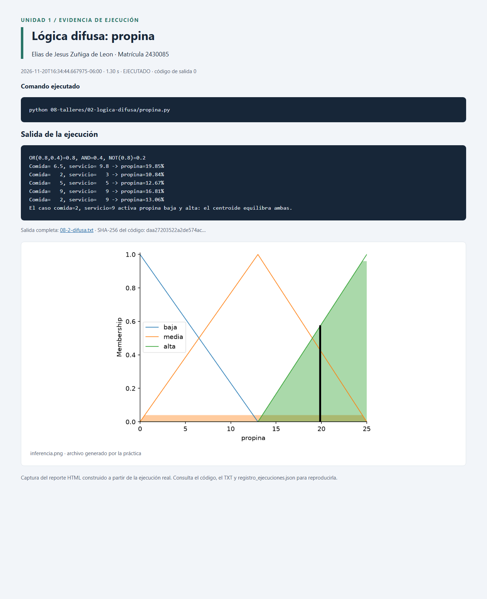

# 8.2. Lógica difusa: sugerencia de propina

[propina.py](propina.py) demuestra OR como máximo, AND como mínimo y NOT como complemento. Después aplica inferencia Mamdani a comida y servicio (0–10), con propina de 0–25 %.

Las tres reglas del taller son: comida mala o servicio malo → propina baja; servicio regular → media; comida buena o servicio bueno → alta. La agregación usa máximo y la defuzzificación usa centroide.

| Comida | Servicio | Resultado ejecutado |
| --- | --- | --- |
| 6.5 | 9.8 | 19.85 % |
| 2 | 3 | 10.84 % |
| 5 | 5 | 12.67 % |
| 9 | 9 | 16.81 % |
| 2 | 9 | 13.06 % |

Con comida mala y servicio excelente se activan reglas bajas y altas; el centroide combina ambas. Estos porcentajes provienen de reglas del ejercicio, no de una recomendación económica.

[Cuaderno](actividad.ipynb) · [Resultados CSV](resultados/casos.csv) · [Gráfica de inferencia](resultados/inferencia.png).

