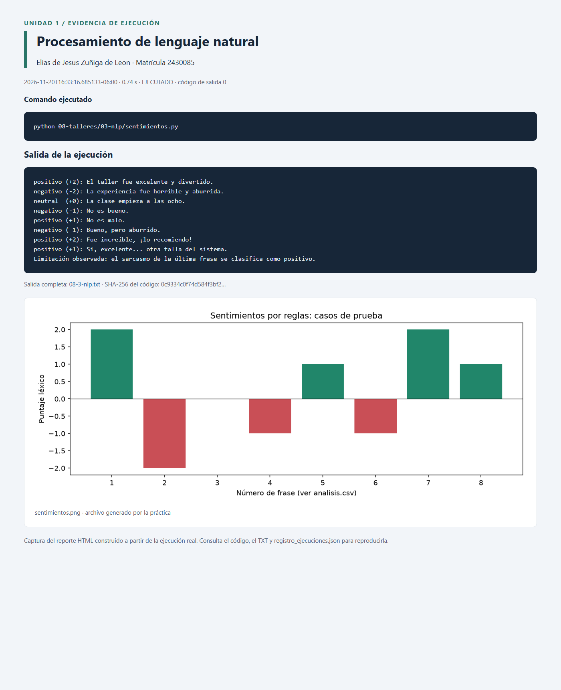

# 8.3. Procesamiento de lenguaje natural: sentimientos

[sentimientos.py](sentimientos.py) tokeniza texto en español, normaliza mayúsculas y acentos, y compara palabras con un pequeño léxico positivo y negativo. El puntaje incorpora una ventana de dos palabras después de una negación y duplica el peso después de `pero` o `aunque`.

```powershell
python sentimientos.py
python sentimientos.py --texto "No es bueno"
```

Se ejecutaron ocho frases con ejemplos positivos, negativos, neutrales, contraste y negación. `No es bueno` produce negativo; `No es malo`, positivo; `Bueno, pero aburrido`, negativo.

Limitación observada: `Sí, excelente... otra falla del sistema.` se clasifica como positivo. El sistema no comprende sarcasmo, contexto amplio ni expresiones fuera del léxico; no es un modelo entrenado y sus ejemplos no representan una evaluación estadística de calidad.

[Cuaderno](actividad.ipynb) · [Resultados CSV](resultados/analisis.csv) · [Explicaciones de los puntajes](resultados/analisis.json).


