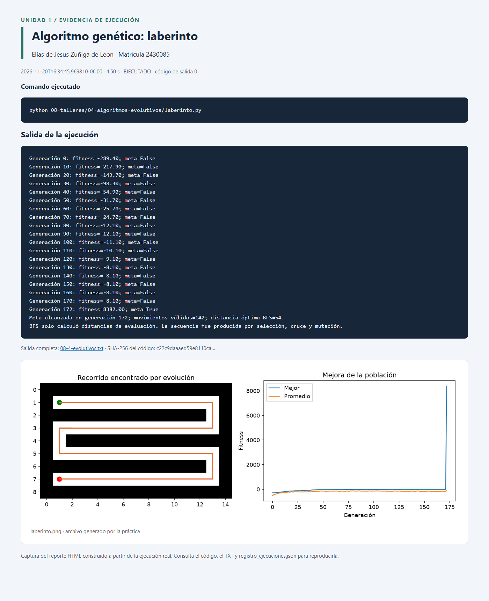

# 8.4. Algoritmo genético para un laberinto

[laberinto.py](laberinto.py) representa cada individuo con 160 movimientos. Evoluciona una población de 240 individuos mediante torneo de cinco candidatos, cruce de un punto, mutación de 0.02 y elitismo de seis individuos. La semilla es 2430085.

La función de fitness premia llegar a la meta y penaliza distancia restante, intentos contra paredes y pasos innecesarios. BFS calcula distancias hasta la meta para evaluar el progreso; no construye ni introduce la secuencia de movimientos de los individuos.

En la ejecución, la población inicial no encontró la salida. El algoritmo la alcanzó en la **generación 172**, con **142 movimientos válidos**. BFS indica que la ruta más corta tiene 54 movimientos: la solución genética encontrada no es óptima. Esto permite observar la mejora del fitness y los límites del algoritmo, sin presentar la primera solución como la mejor posible.

[Cuaderno](actividad.ipynb) · [Genes y recorrido encontrados](resultados/solucion.json) · [Historial de fitness](resultados/evolucion.csv).

Para un laberinto conocido, BFS o A* suelen ser más adecuados; aquí el objetivo es practicar los componentes de un algoritmo evolutivo.

