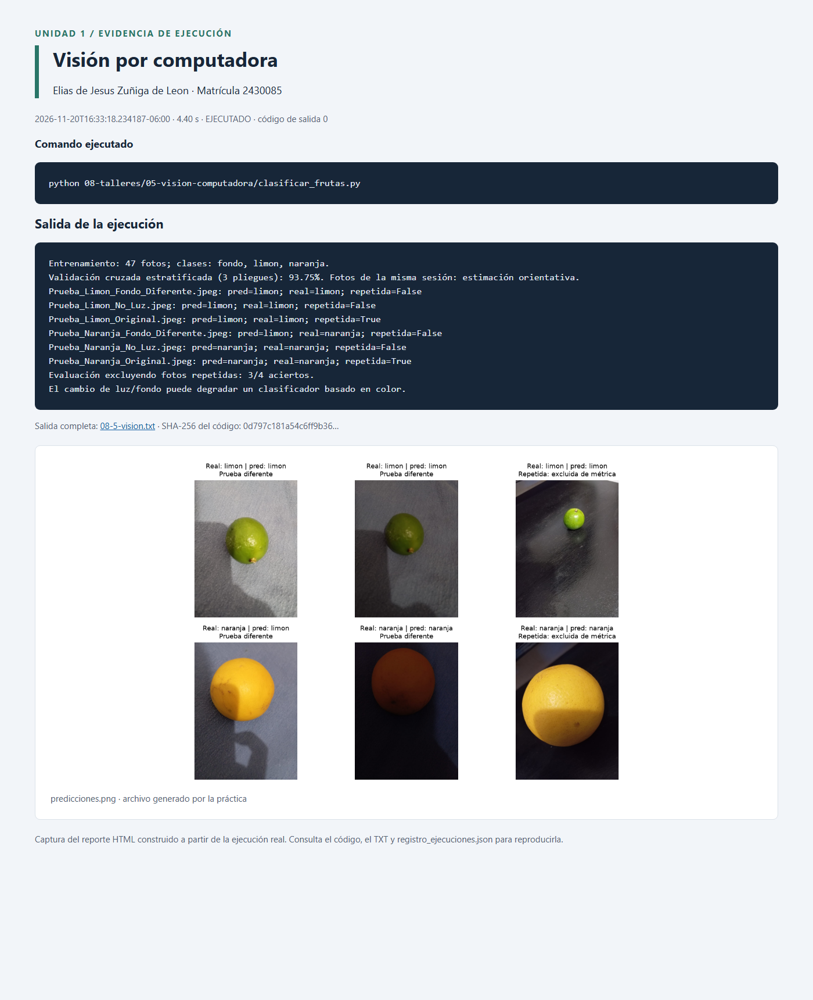

# 8.5. Visión por computadora: limón, naranja y fondo

[clasificar_frutas.py](clasificar_frutas.py) redimensiona las fotos a 96×96 píxeles, calcula histogramas HSV y estadísticas de color, estandariza las características y entrena una regresión logística. Es un clasificador didáctico de imágenes completas; no detecta objetos ni entrena una red convolucional.

Las **47 fotos de entrenamiento** y seis de prueba son datos de entrada del taller compartido en el repositorio de referencia, atribuidos en [REFERENCIAS.md](../../REFERENCIAS.md). Las fotos no fueron tomadas por Elias. El código y las salidas de esta práctica sí se generaron en esta reconstrucción.

Dos fotos de prueba son copias exactas de fotos de entrenamiento. El programa compara sus SHA-256 y las excluye de la métrica. En las **cuatro pruebas diferentes obtuvo 3/4 aciertos**; confundió la naranja con fondo diferente con un limón. La validación cruzada de tres pliegues sobre entrenamiento dio 93.75 %, pero las imágenes de una misma sesión no permiten afirmar que generalice a otros escenarios.

La prueba tiene solo cuatro imágenes diferentes, no evalúa la clase fondo y cambia condiciones de luz o fondo. Los resultados muestran una limitación real de las características basadas en color.

[Cuaderno](actividad.ipynb) · [Predicciones por foto](resultados/predicciones.csv) · [Métricas](resultados/metricas.json) · [Parámetros aprendidos](resultados/modelo.npz).

