# Fundamentos de Inteligencia Artificial · Unidad 1

**Elias de Jesus Zuñiga de Leon** · **Matrícula: 2430085**

Actividades realizadas en la unidad 1 de Fundamentos de Inteligencia Artificial.

## 1. Configuración del entorno de desarrollo

Configuración de Python y verificación de las librerías IPython, Notebook, NumPy, Matplotlib, SciPy y scikit-learn. Se realizó una prueba de regresión para comprobar el funcionamiento del entorno.

[Actividad y código](01-configuracion-entorno/) · [Reporte PDF](01-configuracion-entorno/Configuracion%20de%20entorno%20de%20desarrollo_2430085.pdf)

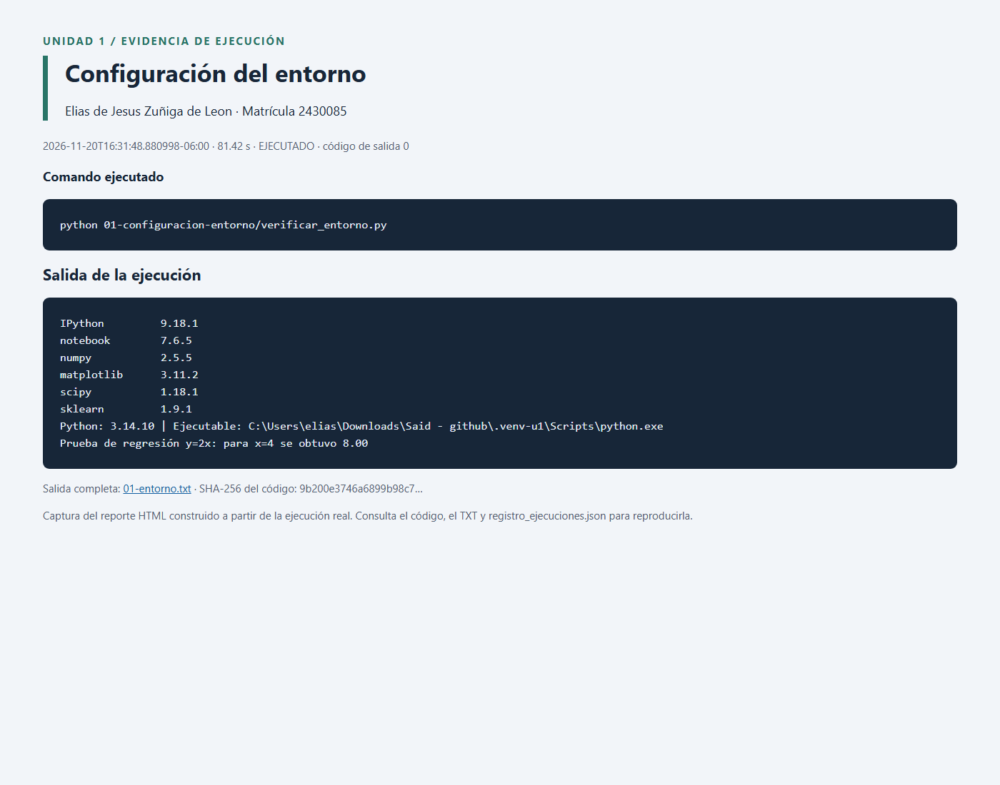

## 2. Historia de la inteligencia artificial

Investigación sobre la historia de la IA y evidencia de la lectura analítica en el cuaderno.

[Reporte PDF](02-investigacion-historia-ia/reporte_historia_ia_2430085.pdf) · [Archivo LaTeX](02-investigacion-historia-ia/reporte_historia_ia_2430085.tex) · [Evidencia del cuaderno](02-investigacion-historia-ia/evidencia_cuaderno_2430085.pdf)

### 2.1. Reporte de historia de la IA

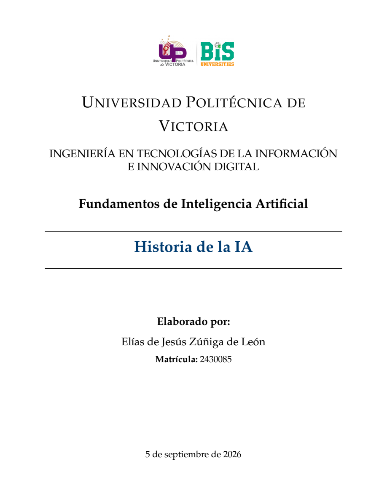

### 2.2. Evidencia del cuaderno

## 3. Mapa mental de agentes inteligentes

Mapa mental sobre agentes inteligentes en la industria, con ejemplos de salud, logística y transporte. Se identifican el entorno, los sensores, los actuadores y el tipo de agente de cada caso.

[Ver actividad](03-mapa-agentes-inteligentes/)

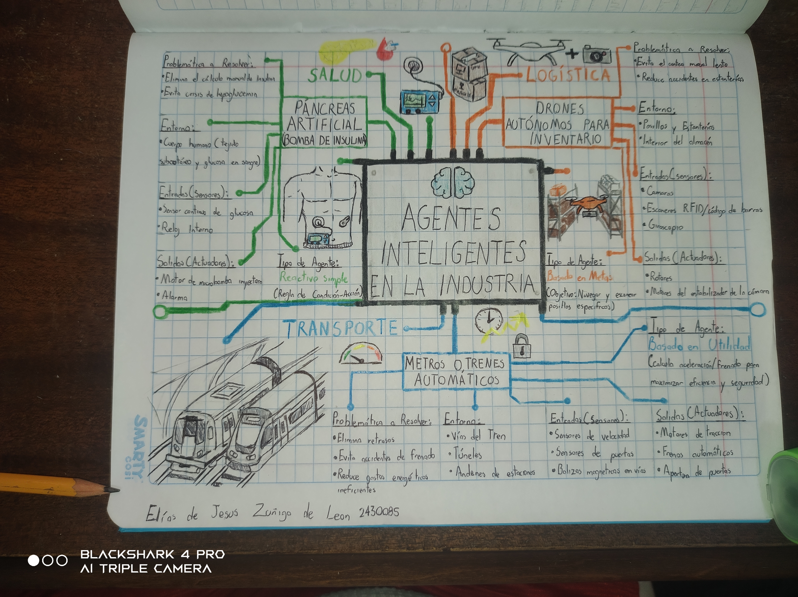

## 4. Limpieza de clientes con Bash

Limpieza de espacios, eliminación de duplicados y registros incompletos, unificación de departamentos y consulta de las personas del área de ventas.

[Código y archivos de la actividad](04-bash-limpieza-clientes/)

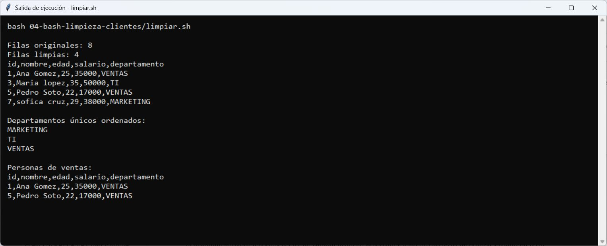

## 5. Preparación de datos de PIB y satisfacción de vida

Unión de los datos de satisfacción de vida y PIB per cápita mediante Bash. Se obtuvieron 36 países y se generaron los archivos de entrada X.csv y salida y.csv.

[Código y datos de la actividad](05-bash-pib-satisfaccion/)

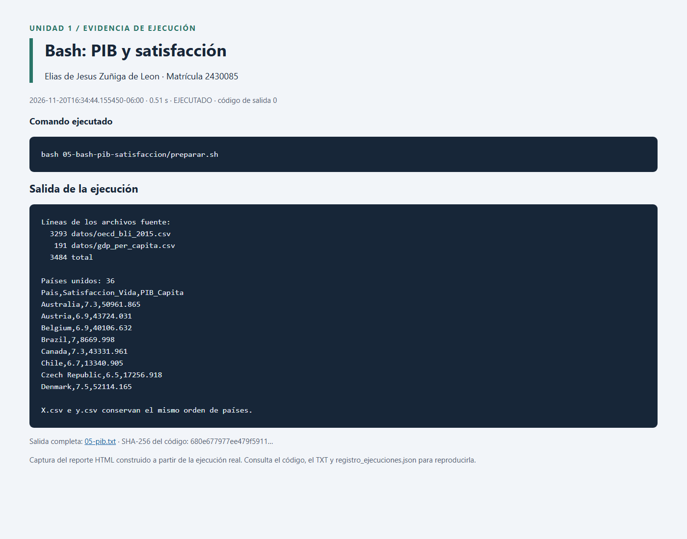

## 6. Lógica proposicional e inferencia

Implementación de operadores lógicos, tablas de verdad, equivalencias e inferencia. Se compararon dos reglas de acceso para observar cómo los paréntesis cambian su resultado.

[Código y cuaderno](06-logica-proposicional/)

## 7. Agentes con CrewAI y Ollama

Ejecución de dos agentes con un modelo local: un analista revisa las fuentes y un redactor elabora el informe a partir del análisis.

[Código de la práctica](07-crewai/) · [Informe generado](07-crewai/resultados/informe.md)

## 8. Taller de red neuronal

Construcción y entrenamiento de una red neuronal con NumPy para clasificar dígitos de MNIST. La evaluación sobre 10 000 imágenes de prueba obtuvo 88.34 % de aciertos.

[Código y cuaderno](08-talleres/01-red-neuronal/)

### 8.1. Entrenamiento y evaluación

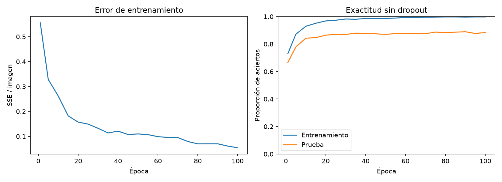

### 8.2. Predicciones de dígitos

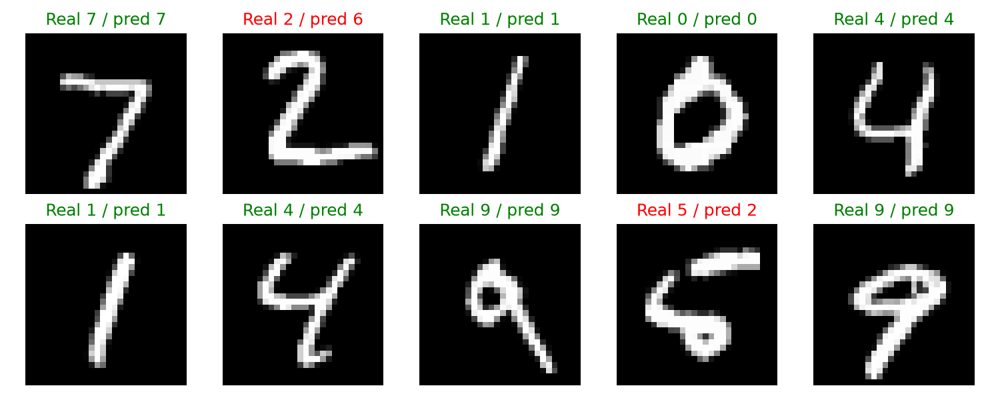

## 9. Taller de lógica difusa

Aplicación de operaciones difusas y de un sistema de inferencia para calcular la propina según la calidad de la comida y del servicio.

[Código y cuaderno](08-talleres/02-logica-difusa/)

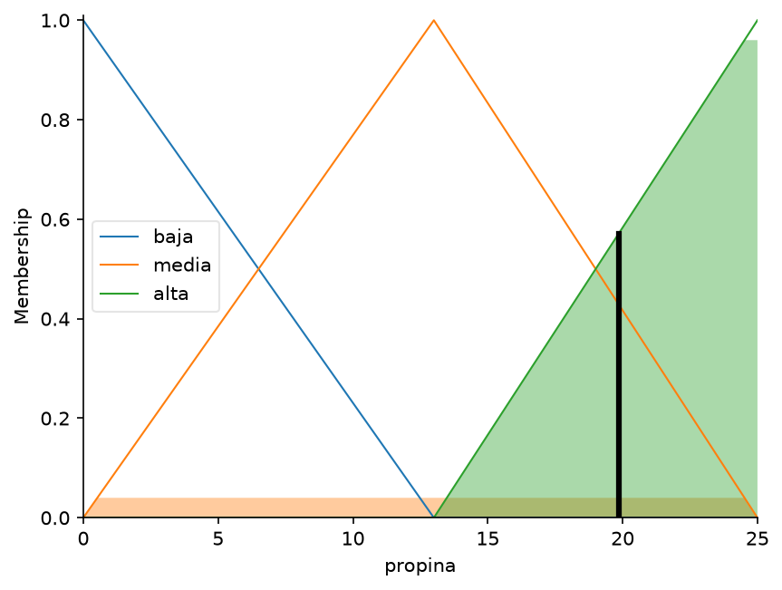

## 10. Taller de procesamiento de lenguaje natural

Análisis de sentimientos en frases en español mediante tokenización, un léxico de palabras y reglas sencillas de negación y contraste.

[Código y cuaderno](08-talleres/03-nlp/)

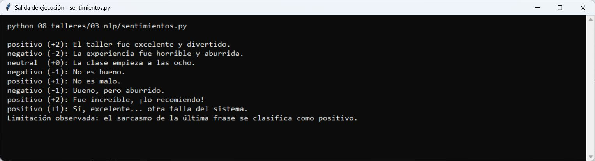

## 11. Taller de algoritmos evolutivos

Resolución de un laberinto mediante un algoritmo genético con selección, cruce, mutación y elitismo. La población alcanzó la meta en la generación 172.

[Código y cuaderno](08-talleres/04-algoritmos-evolutivos/)

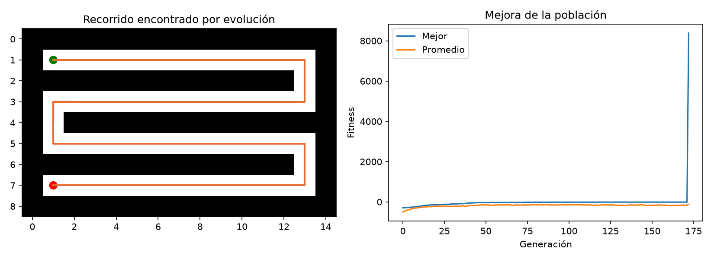

## 12. Taller de visión por computadora

Clasificación de imágenes de limón, naranja y fondo mediante características de color y regresión logística. Se compararon imágenes con cambios de iluminación y fondo.

[Código y cuaderno](08-talleres/05-vision-computadora/)

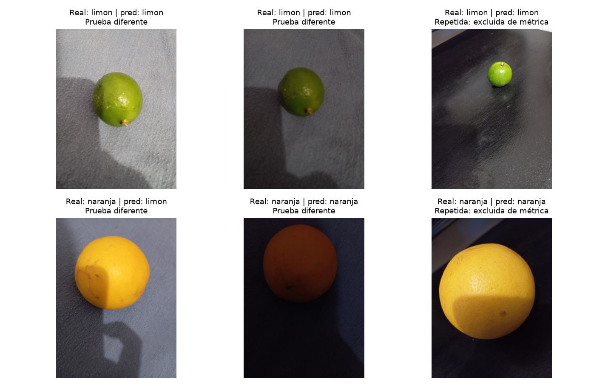
