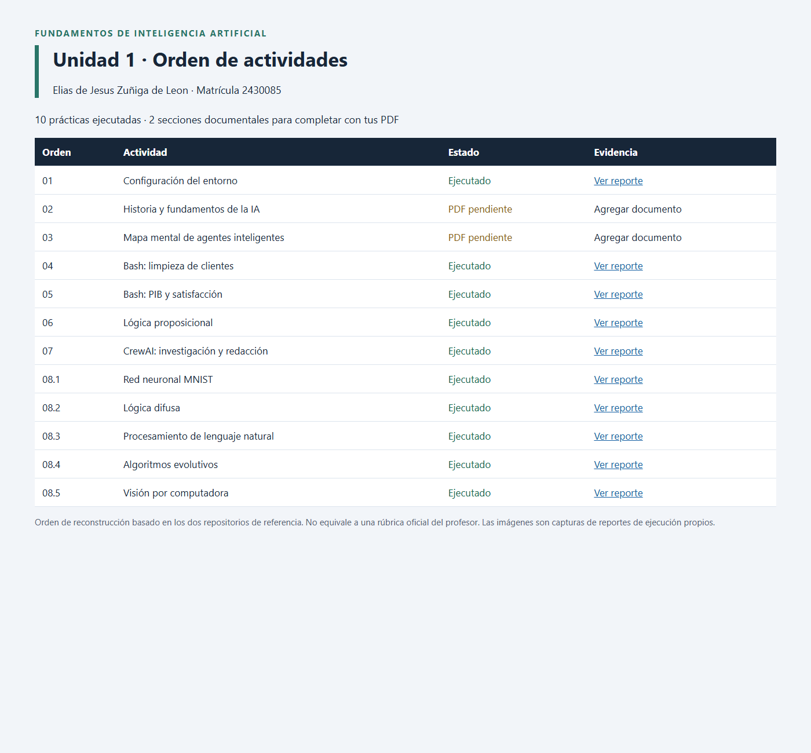

# Fundamentos de Inteligencia Artificial · Unidad 1

**Elias de Jesus Zuñiga de Leon** · **Matrícula: 2430085**

Actividades reconstruidas con código, resultados y evidencias de ejecución. El orden se obtuvo de los [dos repositorios de referencia](REFERENCIAS.md); conviene cotejarlo con la lista del profesor antes de entregar.

| Orden | Actividad | Contenido / estado | Captura |
| --- | --- | --- | --- |
| 1 | [Configuración del entorno](01-configuracion-entorno/) | Python, librerías y prueba de regresión ejecutados | [Ver](evidencias/01-entorno.png) |
| 2 | [Historia y fundamentos de IA](02-investigacion-historia-ia/) | **Pendiente:** agregar reporte y resumen PDF en `documentos/` | Pendiente de tus documentos |
| 3 | [Mapa mental de agentes inteligentes](03-mapa-agentes-inteligentes/) | **Pendiente:** agregar tu PDF en `documentos/` | Pendiente de tu documento |
| 4 | [Bash: limpieza de clientes](04-bash-limpieza-clientes/) | Limpieza, departamentos únicos y filtro de ventas ejecutados | [Ver](evidencias/04-clientes.png) |
| 5 | [Bash: PIB y satisfacción](05-bash-pib-satisfaccion/) | Unión de 36 países; archivos X e y generados | [Ver](evidencias/05-pib.png) |
| 6 | [Lógica proposicional e inferencia](06-logica-proposicional/) | Operadores, tablas de verdad, equivalencias y caso de acceso ejecutados | [Ver](evidencias/06-logica.png) |
| 7 | [CrewAI con Ollama](07-crewai/) | Dos agentes locales ejecutados; análisis e informe generados | [Ver](evidencias/07-crewai.png) |
| 8.1 | [Taller: red neuronal MNIST](08-talleres/01-red-neuronal/) | Red NumPy entrenada y evaluada con 10 000 imágenes | [Ver](evidencias/08-1-red-neuronal.png) |
| 8.2 | [Taller: lógica difusa](08-talleres/02-logica-difusa/) | Propina con inferencia Mamdani y cinco casos ejecutados | [Ver](evidencias/08-2-difusa.png) |
| 8.3 | [Taller: lenguaje natural](08-talleres/03-nlp/) | Análisis de sentimientos con reglas y ocho frases ejecutado | [Ver](evidencias/08-3-nlp.png) |
| 8.4 | [Taller: algoritmos evolutivos](08-talleres/04-algoritmos-evolutivos/) | Laberinto resuelto con un algoritmo genético | [Ver](evidencias/08-4-evolutivos.png) |
| 8.5 | [Taller: visión por computadora](08-talleres/05-vision-computadora/) | Clasificación de limón, naranja y fondo ejecutada | [Ver](evidencias/08-5-vision.png) |

Cada práctica contiene su explicación, código y carpeta `resultados/`. Las capturas muestran reportes HTML construidos con la salida real de los programas; los archivos TXT y [el registro de ejecuciones](evidencias/registro_ejecuciones.json) conservan comandos, fechas, códigos de salida y huellas del código. Son evidencias de la reconstrucción actual.

Para volver a ejecutar, consulta [EJECUTAR.md](EJECUTAR.md). Los siete cuadernos `.ipynb` acompañan a los scripts y muestran sus salidas e imágenes. La [validación final](evidencias/validacion.json) comprueba las diez prácticas, la integridad de los datos, las capturas y los enlaces locales.
